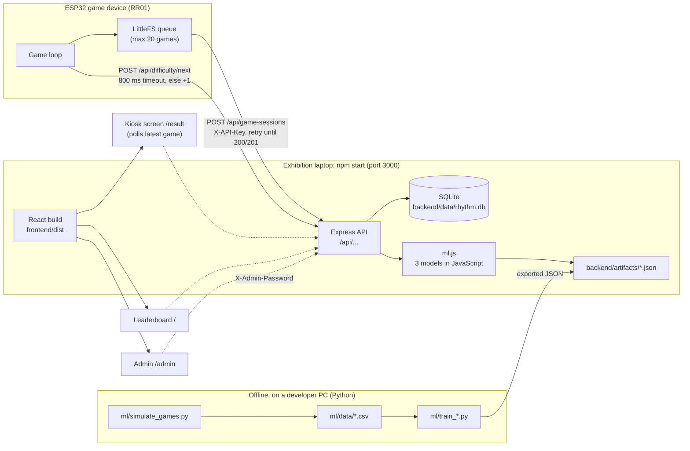

# Rhythm Rush

Rhythm Rush is a 6-button musical memory game for an ESP32. The device plays a
sequence of coloured buttons and the player repeats it; every level adds a
step (Level 1 = 3 steps, Level 15 = 17 steps), the time per press gets
shorter, and three mistakes end the game.

This repository is the **software side**:

- an **Express + SQLite** backend that receives finished games from the ESP32,
- three small **ML models** (trained offline in Python, run in JavaScript):
  adaptive difficulty, skill level, and a "which animal did you play like"
  fun result,
- a **React website**: leaderboard, a live **kiosk screen** that shows each
  new result by itself, a page per game with a chart, and an admin page,
- a **fake ESP32** uploader so everything can be demonstrated without
  hardware,
- the **network layer for the ESP32 firmware** (`/firmware`).

> The models are trained on **synthetic** data. The animal "IQ" is **just for
> fun, not a real IQ test**. See [Limitations](#limitations).

## Architecture



There is **no Python in production**: Express reads the exported JSON models.
One `npm start` serves both the API and the website.

## Folder map

| Folder / file | What is in it |
|---|---|
| `ml/` | `game_rules.py` (all game constants and formulas), `simulate_games.py`, `train_skill.py`, `train_animal.py`, `train_difficulty.py`, `check_exports.py`, `export_test_vectors.py`. `ml/data/` (generated CSVs) is gitignored. |
| `backend/src/` | Express app (`app.js`, `server.js`), routes, services (`ml.js` runs the models, `queries.js`/`admin.js` hold the SQL). |
| `backend/artifacts/` | The three exported models (`difficulty.json`, `skill.json`, `animal.json`). Tracked in git. |
| `backend/tests/` | vitest + supertest tests (in-memory SQLite). |
| `backend/data/` | The SQLite database file. Gitignored. |
| `db/` | `migrations/001_init.sql`, `migrate.js`, `seed.js`. |
| `frontend/` | React + Vite + Tailwind + Recharts website. |
| `tools/` | `fake_esp32.js` (fake uploader, device SIM01), `clear_fake.js`. |
| `firmware/rhythm_rush_client/` | Arduino sketch: Wi-Fi, offline queue, uploads, difficulty call (network layer only). |
| `docs/` | `NOTES.md` (all decisions, metrics, limitations), `API.md`, `FRONTEND.md`, `DEMO.md` (exhibition checklist), `session.schema.json`. |
| `package.json` | Convenience scripts for the whole project (below). |

## Prerequisites

| Tool | Version used | Needed for |
|---|---|---|
| Node.js | 22 LTS (tested 22.14) with npm 10+ | backend, website, fake ESP32 |
| Python | 3.11+ (tested 3.13) | only for fake data and retraining |
| Python packages | scikit-learn 1.9.1, pandas 3.0.5, numpy 2.5.2 | same |
| Git | any | getting the code |

Windows is the main target; every command below is for **PowerShell**. On
macOS/Linux use `python3` instead of `python` and `cp` instead of
`Copy-Item`.

Internet is needed once for `npm install` and `pip install`. The game itself
runs on a local network with no internet.

## Setup from a clean machine

All commands start in the project folder (the one with this README).

```powershell
# 1. Node packages for the backend and the website (takes a minute)
npm run install-all

# 2. Python packages (only needed for fake data and retraining)
python -m pip install scikit-learn==1.9.1 pandas==3.0.5 numpy==2.5.2

# 3. Settings: copy the example, then edit backend/.env
Copy-Item backend/.env.example backend/.env
notepad backend/.env

# 4. Create the database and the two devices (RR01 + simulated SIM01)
npm run migrate
npm run seed

# 5. Build the website
npm run build

# 6. Start everything (API + website) on port 3000
npm start
```

Open <http://localhost:3000>. The terminal also prints the address for other
devices on the network, for example `http://192.168.1.5:3000`.

For development the example `.env` values work as they are. **For the
exhibition**, follow [docs/DEMO.md](docs/DEMO.md): `NODE_ENV=production` and
real random values for `DEVICE_API_KEY`, `SIM_API_KEY` and `ADMIN_PASSWORD`.

### Pages

| URL | Page |
|---|---|
| `/` | Leaderboard (top 20, refreshes every 10 s); click a row for details |
| `/result` | **Kiosk screen**: shows every new game for 30 s, nickname entry, then back to waiting |
| `/result/<session id>` | The result screen of one game |
| `/session/<session id>` | One game: facts, ML results, response-time chart, attempts table |
| `/admin` | Admin dashboard (password = `ADMIN_PASSWORD`); not linked anywhere |

### Project scripts (run in the project folder)

| Command | What it does |
|---|---|
| `npm run install-all` | `npm install` in `backend/` and `frontend/` |
| `npm run migrate` / `npm run seed` | create / fill the database (safe to repeat) |
| `npm run build` | build the website into `frontend/dist` |
| `npm start` | start the server (API + website) |
| `npm run dev:frontend` | Vite dev server on port 5173 with hot reload (run `npm start` too) |
| `npm run test-all` | backend tests, frontend tests, lint, ML checks (needs `npm run simulate` once) |
| `npm run simulate` | generate the synthetic games in `ml/data` (2,000 games, seed 42) |
| `npm run retrain` | train all three models and check the exports |
| `npm run fake` | upload 20 fake games + 1 duplicate to `localhost:3000` |

PowerShell 5.1 drops the `--` in `npm run x -- --flag`. To pass your own
options, call the script directly, e.g. `node tools/fake_esp32.js --count 30`.

## Demo without hardware

The fake ESP32 replays synthetic games through the real upload endpoint as
device **SIM01**. It needs the synthetic CSVs once:

```powershell
npm run simulate                 # creates ml/data/*.csv (once)
npm start                        # terminal 1, keep it open
```

Open <http://localhost:3000/result> (the kiosk screen), then in terminal 2:

```powershell
node tools/fake_esp32.js --count 1 --seed 3            # one game: watch /result
node tools/fake_esp32.js --count 30 --duplicate        # 30 games + a resent duplicate
node tools/fake_esp32.js --help                        # all options
```

If you changed `SIM_API_KEY` in `backend/.env`, add `--key <that value>`.
Remove fake games on the admin page ("Remove simulated games") or with
`node tools/clear_fake.js` (dry run) and `node tools/clear_fake.js --yes`
(run from `backend/`).

## How the ESP32 connects

- **URL:** `http://<laptop-local-ip>:3000` (the IP printed by `npm start`,
  e.g. `http://192.168.1.5:3000`). The laptop and the ESP32 must be on the
  same Wi-Fi. Give the laptop a fixed IP (DHCP reservation) so the address
  does not change between days.
- **Upload:** `POST /api/game-sessions` with header `X-API-Key:
  <DEVICE_API_KEY>` and a JSON body exactly as in
  [`docs/session.schema.json`](docs/session.schema.json). Answer `201` =
  saved, `200 {"duplicate":true}` = already saved (same `session_id`).
- **Offline queue:** the ESP32 saves each finished game to flash first and
  deletes it **only after 200 or 201**; anything else (no Wi-Fi, timeout, 5xx)
  keeps it and retries later with backoff. Because the server ignores a
  repeated `session_id`, a retry can never create a double entry.
- **Unique ids:** `"<DEVICE_ID>-<counter>"`, with the counter stored in flash
  so ids never repeat after a reboot.
- **Difficulty:** between levels the ESP32 may call `POST
  /api/difficulty/next` with an 800 ms timeout; on any failure it simply adds
  +1 step. Gameplay never waits for the server.
- A ready-made Arduino network layer is in
  [`firmware/rhythm_rush_client`](firmware/rhythm_rush_client/README.md).
  Full API reference: [`docs/API.md`](docs/API.md).

### Windows firewall (port 3000)

Windows blocks incoming connections by default, so the ESP32 and the kiosk
screen cannot reach the laptop until port 3000 is allowed. Set the Wi-Fi to
**Private** (Settings > Network & Internet > Wi-Fi > your network), then in an
**administrator** PowerShell:

```powershell
New-NetFirewallRule -DisplayName "Rhythm Rush 3000" -Direction Inbound -Protocol TCP -LocalPort 3000 -Action Allow -Profile Private
```

(Or click "Allow" for Node.js on **private** networks when Windows asks the
first time you run `npm start`.) Remove the rule after the event with
`Remove-NetFirewallRule -DisplayName "Rhythm Rush 3000"`.

## Retrain with real data

The models were trained on synthetic games. To retrain on real games:

1. **Export** real finished games to the same columns as the synthetic files:
   `ml/data/games.csv` (one row per game: `session_id`, `final_score`,
   `avg_reaction_sec`, `success_rate`, `highest_sequence_length`,
   `skill_label`, `next_level_steps`, `outcome`, `final_level_attempted`,
   `successful_rounds`, `failed_attempts`, `total_attempts`),
   `ml/data/attempts.csv` (one row per attempt) and
   `ml/data/players_hidden.csv` (`session_id`, `player_type`, plus the two
   hidden columns if you have them). The column definitions are in
   [`docs/NOTES.md`](docs/NOTES.md) ("Data dictionary"). The features are
   already computed per game in the `session_features` table, the attempts
   are in `level_attempts`.
2. **Labels** (`skill_label` / `player_type`) must come from a real labelling
   process (for example a teacher's judgement), **not** from score
   percentiles. `next_level_steps` is a bootstrap rule today; replace it with
   the progression you actually want.
3. Keep a copy of the old `backend/artifacts` (git has it), then run
   `npm run retrain` (the three `train_*.py` scripts and `check_exports.py`).
   Do **not** run `npm run simulate` afterwards: it overwrites `ml/data`.
4. Optionally run `python ml/export_test_vectors.py` and `npm --prefix
   backend test` so the JavaScript models are checked against Python again.
5. **Restart** the server (`npm start`); models are loaded once at start. The
   admin page's Models section shows the new file dates.

## Troubleshooting

| Problem | Fix |
|---|---|
| `npm start` says "address already in use" | Another server is on port 3000. Close it, or set `PORT=3001` in `backend/.env`. |
| ESP32 / phone cannot reach the laptop | Same Wi-Fi? Use the IP printed by `npm start`, not `localhost`. Network set to Private and the firewall rule added? Some school/guest Wi-Fis block device-to-device traffic ("client isolation"): use a phone hotspot or your own router. |
| Upload answers `401 unauthorized` | `X-API-Key` does not match. The DB stores the hash from the **first** `npm run seed`; after changing `DEVICE_API_KEY`, delete `backend/data/rhythm.db*` and run migrate + seed again. |
| Upload answers `403 device_mismatch` | `device_id` in the JSON is not the device that owns the key. |
| Website shows "Cannot reach the server" | The backend is not running, or the page was opened from another port. |
| `npm start` prints "website: NOT built" | Run `npm run build`. |
| `/admin` says the admin API is switched off | `ADMIN_PASSWORD` is empty, or still `change-me` with `NODE_ENV=production`. Set a real one, restart. |
| `/admin` says "Too many wrong passwords" | Wait 15 minutes or restart the server. |
| `npm run seed` refuses the keys | `NODE_ENV=production` with example keys. Put real random keys in `backend/.env`. |
| `fake_esp32.js` cannot find `games.csv` | Run `npm run simulate` once. |
| `fake_esp32.js` gets `401` | `SIM_API_KEY` was changed: pass `--key <value>`. |
| `npm install` fails building `better-sqlite3` | Use Node 22 LTS (a prebuilt binary exists for it); delete `node_modules` and try again. |
| vitest fails with `Cannot read properties of undefined (reading 'config')` | The terminal's drive letter is lowercase (`c:\...`, seen in Git Bash). Use PowerShell, or `cd` into the folder with `C:\`. |
| `npm run x -- --flag` ignores the flag | PowerShell 5.1 drops `--`; run the script with `node ...` directly. |
| New model files have no effect | Restart the server; models are cached at start. |

## Tests

```powershell
npm run simulate     # once, the ML checks need ml/data
npm run test-all
```

This runs the backend tests (vitest + supertest on in-memory SQLite), the
frontend unit tests, the frontend lint, the game-rules self-check, and
`check_exports.py` (the exported JSON must match scikit-learn).

## Limitations

- **Synthetic-data models.** All three models were trained on 2,000 simulated
  games. Their scores say how well they learned the simulator, not how well
  they judge real players.
- **The difficulty target is a bootstrap rule**, not ground truth: the
  regression (R² 0.79) only reproduces a hand-written rule.
- **The skill classifier is 66.5 % accurate** on held-out synthetic games
  (Pro recall about 50 %). Mistakes stay between neighbouring levels.
- **Animal IQ is just for fun**, not a real IQ test.
- **The nickname route is public** (the kiosk has no key) and session ids are
  guessable: anyone on the network can name a game that has no nickname yet.
  The set-once rule, a rate limit and the admin "Clear nickname" button limit
  the damage. Run it on a **trusted network**.
- **Plain HTTP on the LAN.** API keys and the admin password travel
  unencrypted. Fine on an isolated classroom network, not on the internet
  (that needs HTTPS and certificate checking on the ESP32).
- **Rate limiters keep their counters in memory**: a restart resets them, and
  they are per server process.
- **SQLite has a single writer.** Perfect for one laptop and a few devices; not
  meant for many servers or heavy parallel writes.
- **The kiosk shows only the newest game.** Two games finished within one
  2-second poll show only the latest; queued offline uploads appear as new
  results when they arrive.

More detail on every decision is in [`docs/NOTES.md`](docs/NOTES.md).
